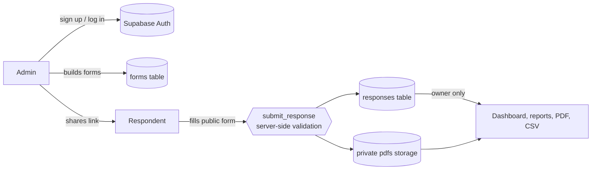

<div align="center">


# Formora

**One system, and every admin gets their own form builder, response dashboard and reports.**

Build forms · Share by link · Review responses · Download reports


</div>

---

## ✨ Features

| Feature | Details |
|---|---|
| **Admin sign up / log in** | Email and password. A 6-digit OTP verifies the email once at sign up, then login needs no OTP. Forgot password also uses an OTP. Google sign-in is optional. |
| **Separate dashboards** | Each admin sees only their own forms and responses. This is enforced in the database (Row Level Security), not just in the front end. |
| **Form builder** | 11 field types, reorderable fields, Required, help text under each question, Draft / Publish. |
| **Banner and description** | A fixed-size banner (1200 × 300 px, other images are auto-cropped), a form description and a custom thank-you message. |
| **Survey mode** | Linear scale (1–3 up to 1–10). Turn on Survey mode and respondents don't see the PDF buttons. |
| **Reports** | Date and search filters, a summary (totals, responses per day, answer counts, scale averages) and **PDF** and **CSV** downloads. |
| **PDF per submission** | A4 letterhead style with a logo watermark. Saved in private storage, readable only by the form owner. |
| **Public form link** | Anyone can submit through `form.html?id=...` without logging in. Validation also runs on the server. |
| **Demo mode** | Works without Supabase. Data stays in that browser only. |

### Field types

`Text` · `Long text` · `Number` · `Email` · `Date` · `Dropdown` · `Radio` · `Checkbox` · `Linear scale` · `Formal photo` · `Signature`

> The image from a **Formal photo** field is not stored separately. It exists only inside that submission's PDF. A **Signature** field appears in the PDF as a blank box and line, so it can be printed and signed by hand.

---

## 🧭 How it works



---

## 🛠️ Tech stack

- **Front end:** plain HTML, CSS and JavaScript (no build step, no framework)
- **Back end:** [Supabase](https://supabase.com) (Postgres, Auth, Storage)
- **PDF:** `html2canvas` + `jsPDF`, generated in the browser
- **Hosting:** any static host (Netlify, Vercel, Cloudflare Pages, GitHub Pages)

---

## 📁 Project structure

```text
.
├── index.html                 Admin site (login, dashboard, builder, responses)
├── form.html                  Public form (what respondents see)
├── privacy.html               Privacy policy
├── css/
│   └── style.css              Styling for the whole site
├── js/
│   ├── common.js              Supabase config, API layer, demo mode, PDF engine
│   ├── admin.js               Auth, dashboard, builder, responses and reports
│   └── form.js                Public form rendering, validation, submit
├── supabase/
│   ├── schema.sql             Full database schema for a new project
│   ├── update_open_signup.sql Upgrade from the old schema to open sign up
│   └── update_v6_survey.sql   Update for banner, description and scale features
└── logo/                      Logos and favicons
```

---

## 🚀 Setup (step by step)

### 1. Create a Supabase project
Go to [supabase.com](https://supabase.com) and choose **New project**. Set a strong database password and pick the region closest to your users (for example Singapore).

### 2. Run the database schema
Open **SQL Editor → New query**, paste all of `supabase/schema.sql` and click **Run**.

> If your project already ran an older schema, do not run `schema.sql` again. Just run `supabase/update_v6_survey.sql` once to enable the banner, description and scale features.

### 3. Configure email auth
Under **Authentication → Sign In / Providers → Email**:

- **Confirm email:** on
- **Minimum password length:** `8`
- **Email OTP length:** `6`

### 4. Put the OTP code in the email templates
Under **Authentication → Emails → Templates**, edit both **Confirm signup** and **Reset Password**:

```html
<h2>Your Formora code</h2>
<p>Your verification code is: <b>{{ .Token }}</b></p>
```

Without `{{ .Token }}` the email will contain a link instead of a code.

### 5. URL configuration
Under **Authentication → URL Configuration**, set **Site URL** and **Redirect URLs** to your site address. Use `http://localhost:5500` while testing locally, and add your real domain later.

### 6. Add your keys
From **Project Settings → API**, copy the **Project URL** and the **anon public key** into the top of `js/common.js`:

```js
const SUPABASE_URL      = "https://xxxxxxxx.supabase.co";
const SUPABASE_ANON_KEY = "eyJ...";
```

> ⚠️ Use only the **anon** key. Never put the `service_role` key in front-end code.

### 7. (Optional) Google sign-in
Enable **Authentication → Providers → Google** and create an OAuth client in Google Cloud Console. The authorized redirect URI is:

```text
https://<your-project-id>.supabase.co/auth/v1/callback
```

### 8. Run it
Open `index.html` with the VS Code **Live Server** extension. Login does not work if you open the file directly via `file://`.

### 9. Set up SMTP before real use
Supabase's default email service is very limited (it only sends to your team members' addresses and has a low rate limit). For real users, add your own SMTP under **Authentication → SMTP Settings** (a Gmail App Password, Resend or Brevo). Without it you will see `Error sending confirmation email`.

---

## 👩‍💻 Usage

1. **Sign up** and verify with the 6-digit code sent to your email.
2. On the dashboard, click **+ New form**. Add your organization details, logo, banner and description.
3. Use **+ Add field** to add fields and the ↑ ↓ buttons to reorder them.
4. **Publish** the form, then use **Copy link** to share it.
5. On the **Responses** page, search and filter by date, read the summary, then use **Download PDF** or **Download CSV**.

---

## 🔒 Security

- **Row Level Security** is on for every table, so nobody but the owner can read forms or responses.
- Public submissions go through the `submit_response()` function only. It re-checks each field's type, Required, email, number, date, options and scale value on the server.
- Submission PDFs live in a **private bucket** (8 MB max, PDF only).
- A hidden honeypot field helps against spam.
- CSV export neutralizes cells that start with `=`, `+`, `-` or `@`, so Excel will not run them as formulas.
- Passwords are hashed by Supabase Auth and are never visible to us.

---

## ⚠️ Limits

| Item | Limit |
|---|---|
| Fields per form | 60 |
| Responses loaded in the dashboard at once | latest 2000 |
| Banner | 1200 × 300 px (images are auto-cropped and compressed) |
| Description | 1000 characters |
| A single answer | 2000 characters |

---

## 🗺️ Roadmap

- [ ] Multiple sections / pages
- [ ] Multiple choice grid
- [ ] One submission per person limit
- [ ] Pagination for responses
- [ ] Pie charts in the summary
- [ ] Rate limiting on the public form
- [ ] Delete account button on the dashboard

---

## 📬 Contact

**Onu- অণু**
✉️ [onu.creates@gmail.com](mailto:onu.creates@gmail.com)

Privacy information: [`privacy.html`](privacy.html)

---

<div align="center">

© 2026 Formora · by **Onu- অণু**

</div>
